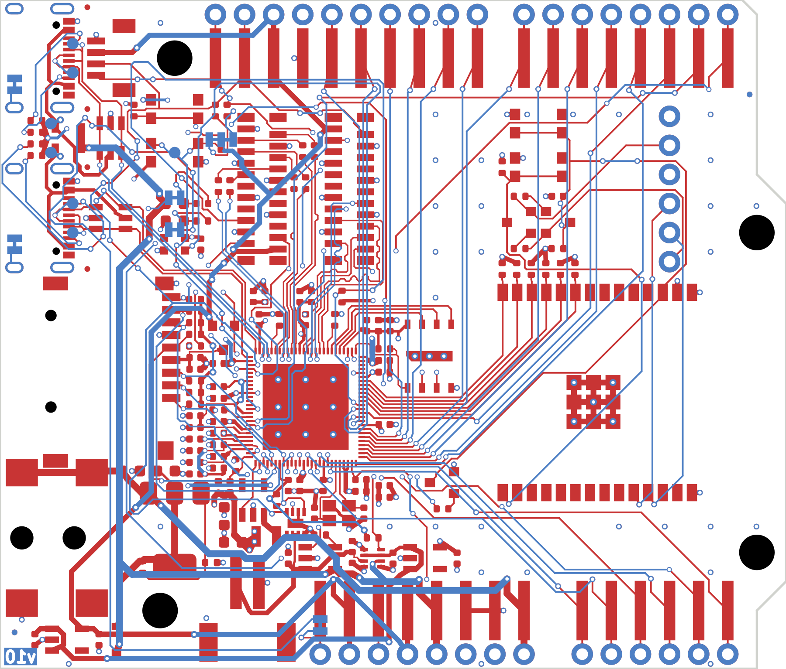

# redboard-route-bt-a-20261116-1017

| | |
|---|---|
| Task | route only, placement kept |
| Model | claude-fable-5-2 (Claude Code, `claude -p`) |
| Tools given | bt (see the README) |
| Time | 2:54 (finished on its own) |
| Cost at API prices | $49.55 |
| Turns | 247 |
| DRC errors | 0 |
| Unconnected | 0 |
| Copper | 3547 mm of track, 379 vias |
| Hosts reached | api.anthropic.com (13), http-intake.logs.us5.datadoghq.com (169) |

DRC is KiCad 10 with zones refilled, on the board the agent saved. Some boards start with findings of their own; see `../../boards/README.md`.

## Pictures

Start is the board as the agent got it (pads and part outlines; in placement runs the free parts sit in a grid below the board). Reference is the human-routed original ([boards/redboard-p4-wifi](../../boards/redboard-p4-wifi)). The copper pictures show F.Cu (red) and B.Cu (blue) with zone fills left out so the tracks show; DRC errors are circled in magenta on the result.

| Start | Reference | Result |
|---|---|---|
|  |  |  |

## The agent's own summary

From the start of its [NOTES.md](work/NOTES.md):

> Placement is untouched (`bt same` against the original: see the end). Only tracks, vias, zones, net classes were added. Read "Known weaknesses" before ordering: the board is fully connected and DRC-clean for copper, but parts of it are not what I would call finished work.

Its review of the bt tool: [BT-REVIEW.md](work/BT-REVIEW.md).

## Progress log

Saved by the agent as it worked, failed attempts included. The notes are here; the pictures are in the archive.

- [001 – starting point](work/progress/001-start.md)
- [002 – ESP32-P4 top-side escape, DSI/CSI/flash by hand](work/progress/002-u1-top-escape.md)
- [003 – bottom-layer pairs, USB breakouts, skew tuning](work/progress/003-pairs.md)
- [004 – ESP32-P4 left/bottom/right sides](work/progress/004-u1-all-sides.md)
- [005 – plane vias, SD bus, LDO rails (several failed attempts)](work/progress/005-planes-sd-rails.md)
- [006 – autoroute of the remaining signals (discarded)](work/progress/006-autoroute-attempt.md)
- [007 – restructured escape, ordered re-route](work/progress/007-restructure.md)
- [008 – all signals connected, but In2 round U1 is a patchwork](work/progress/008-in2-after-routing.md)
- [009 – final board](work/progress/009-final.md)

## Raw files

The prompt is [brief.md](brief.md); the scores are [report.json](report.json). Everything else is in `redboard-route-bt-a-20261116-1017.tar.xz`, attached to the `runs-2026-11` release:
the full transcript (`transcript.jsonl`), the input board, the agent's working directory with its scripts and intermediate boards, the progress pictures, all renders, the raw DRC and metrics, and the proxy log.
