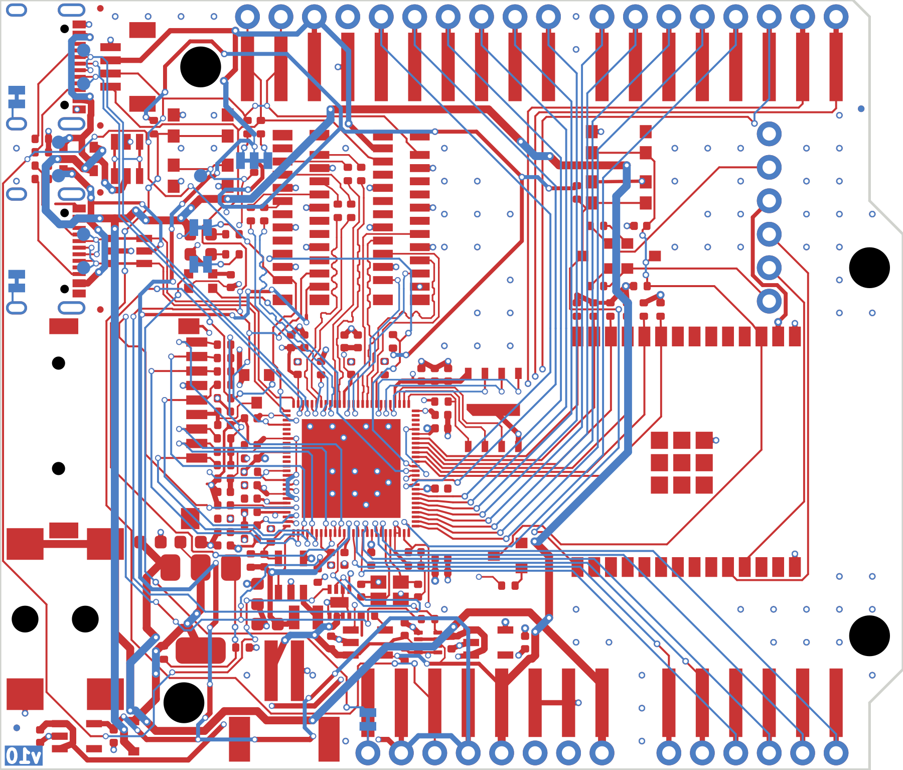

# redboard-route-bt-b-20261116-1017

| | |
|---|---|
| Task | route only, placement kept |
| Model | claude-fable-5-2 (Claude Code, `claude -p`) |
| Tools given | bt (see the README) |
| Time | 3:16 (finished on its own) |
| Cost at API prices | $43.37 |
| Turns | 35 |
| DRC errors | 0 |
| Unconnected | 0 |
| Copper | 3842 mm of track, 423 vias |
| Hosts reached | api.anthropic.com (24), http-intake.logs.us5.datadoghq.com (153) |

DRC is KiCad 10 with zones refilled, on the board the agent saved. Some boards start with findings of their own; see `../../boards/README.md`.

## Pictures

Start is the board as the agent got it (pads and part outlines; in placement runs the free parts sit in a grid below the board). Reference is the human-routed original ([boards/redboard-p4-wifi](../../boards/redboard-p4-wifi)). The copper pictures show F.Cu (red) and B.Cu (blue) with zone fills left out so the tracks show; DRC errors are circled in magenta on the result.

| Start | Reference | Result |
|---|---|---|
|  |  |  |

## The agent's own summary

From the start of its [NOTES.md](work/NOTES.md):

> Result: `SparkFun_IoT_RedBoard-ESP32-P4_WiFi_BLE.kicad_pcb` is fully routed (2073 track segments, 423 vias, 5 zones).
> KiCad 10 DRC incl. schematic parity: 0 unconnected, 0 parity errors, no clearance/short/width errors.
> What remains in the report: 12 courtyard overlaps and 4 silkscreen-edge warnings that were already in the placed board, and 4 "via dangling" warnings (see below).
> No footprint was moved (checked: position/rotation/side of all 292 identical to the original).

Its review of the bt tool: [BT-REVIEW.md](work/BT-REVIEW.md).

## Progress log

Saved by the agent as it worked, failed attempts included. The notes are here; the pictures are in the archive.

- [001 – starting point](work/progress/001-start-unrouted.md)
- [002 – MIPI and USB-HS pairs first](work/progress/002-critical-pairs.md)
- [003 – U1 fan-out: flash, C5 SDIO, SD card, core power](work/progress/003-u1-fanout-sd-flash-c5.md)
- [004 – first autoroute of the remaining signals (partly thrown away)](work/progress/004-autoroute-signals.md)
- [005 – planned east bus, ADC bundle, second autoroute](work/progress/005-east-bus-and-adc.md)
- [006 – every signal and power net connected (GND still to do)](work/progress/006-all-signals-and-power.md)
- [007 – grounding, DRC rounds, skew tuning, final file](work/progress/007-grounded-drc-clean.md)

## Raw files

The prompt is [brief.md](brief.md); the scores are [report.json](report.json). Everything else is in `redboard-route-bt-b-20261116-1017.tar.xz`, attached to the `runs-2026-11` release:
the full transcript (`transcript.jsonl`), the input board, the agent's working directory with its scripts and intermediate boards, the progress pictures, all renders, the raw DRC and metrics, and the proxy log.
